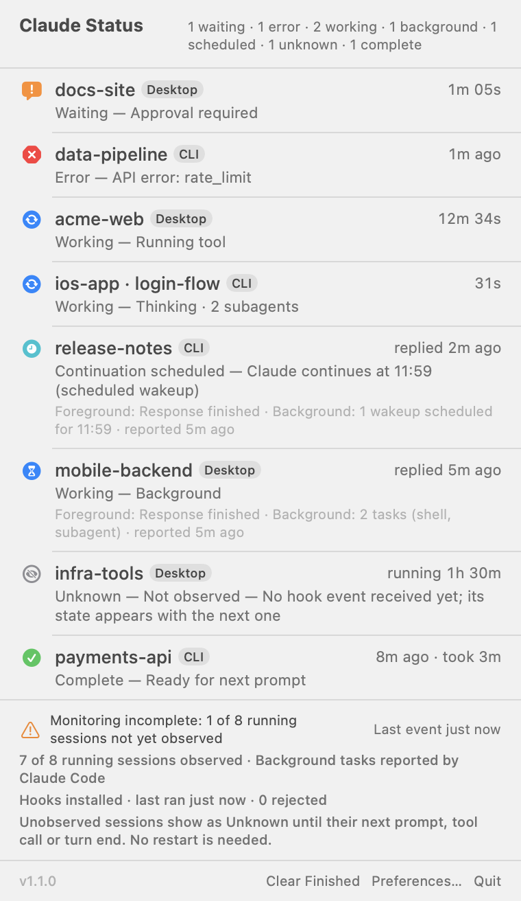
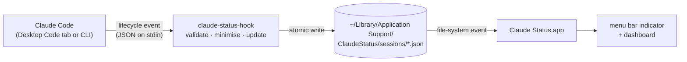

# Claude Status

**See what every local Claude Code session is doing — from the macOS menu bar.**

When you run several Claude Code sessions at once (in the Claude desktop app's Code tab, in
terminals, across projects and worktrees), it is easy to miss the one that has been waiting
for your approval for ten minutes, or to keep checking a window that finished long ago.
Claude Status puts one small indicator in the menu bar: **working** (including background
work Claude is still waiting on), **continuation scheduled**, **waiting for you**,
**complete**, **failed** or **unknown**, with a dashboard of every session one click away.

> Claude Status is an independent, unofficial open-source project. It is not affiliated with,
> sponsored by or endorsed by Anthropic. "Claude" and "Claude Code" are trademarks of Anthropic.

<p align="center">
  <picture>
    <source media="(prefers-color-scheme: dark)" srcset="docs/images/dashboard-dark.png">
    
  </picture>
  &nbsp;&nbsp;
  <picture>
    <source media="(prefers-color-scheme: dark)" srcset="docs/images/menubar-dark.png">
    
  </picture>
</p>

<sub>Screenshots are rendered by the app itself (`ClaudeStatus --render-snapshots DIR`) using demo sessions.</sub>

## Features

- **One glanceable indicator** whose colour *and* symbol show the most urgent state across all
  sessions, plus the number of sessions still working.
- **Session dashboard:** project (and git worktree), client (Desktop / CLI), state and reason
  ("Approval required", "API error: rate_limit", "2 subagents"…), live turn timer or time since
  completion with turn duration, and monitoring health.
- **Honest states.** A session is only *Complete* when Claude Code reports that the response
  finished **and** that no background work (background commands, subagents, monitors,
  scheduled wakeups) is still running. While background work runs the session stays
  *Working — Background* (with when it was last reported), a pending wakeup shows
  *Continuation scheduled* with its time, and a new turn while such work was pending shows
  *Working — Continuing*. Silence and interrupts Claude Code does not report become
  *Unknown*, never *Complete*; every row says how confident the state is and why.
- **Nothing hidden.** Claude Code sessions that are running but have not sent an event yet
  (for example, started before installation and idle since) are listed as *Unknown — Not
  observed*, and health shows coverage ("3 of 4 running sessions observed").
- **Optional notifications** for completion, approval requests and errors. All are off by default.
- **Native and light:** Swift/SwiftUI, Apple silicon, about 3 MB, idle CPU well under 0.1 %,
  about 20 MB of memory, hook ≈2 ms. No Electron, Node, Docker, network access, telemetry or
  listening ports.
- **Supportable:** `claude-status-ctl diagnose`, `selftest`, and `report` (a sanitized report
  for bug reports: no session ids, project names, paths or content).
- **Safe integration:** uses Claude Code's documented [hooks](https://code.claude.com/docs/en/hooks).
  The hook always exits successfully and prints nothing, so it can never block or change a
  Claude turn.

## Requirements and compatibility

- **Mac:** Apple silicon (arm64) only.
- **macOS:** 14 Sonoma or later (deployment target). CI builds and tests on macOS 15; real-world
  acceptance testing was done on macOS 27.2.
- **Claude Code:** a version with lifecycle hooks, including `StopFailure` and
  `PermissionRequest`. Verified with Claude Code CLI 2.1.325 and the Claude Code build bundled
  with Claude Desktop (2.1.330).

| Interface | Status (1.1.0) | Evidence |
|---|---|---|
| **Claude Desktop — Code tab** (local sessions) | ✅ Verified | Dedicated test sessions on Claude Desktop with Claude Code 2.1.330: working/complete, multiple background commands incl. a failing one, background cancellation, background subagent, monitor, scheduled wakeup and its cancellation, approval request (Waiting → approved → Working), Stop button during a tool and during text generation, 24-minute background task across an app restart |
| **Claude Code CLI** (interactive and `claude -p`) | ✅ Verified | `scripts/acceptance/cli_acceptance.py` on CLI 2.1.325: the same scenarios plus permission decline, questions, Esc during a tool and during text, two concurrent sessions in one folder, SIGKILL; 31-minute soak test |
| Several concurrent sessions (Desktop + CLI, many projects) | ✅ Verified | Tracked individually and aggregated |
| Claude Desktop — Chat | ❌ Not supported | Chats do not run Claude Code or its hooks |
| Cowork | ❌ Not supported | No documented hook integration |
| Cloud, remote or SSH sessions | ❌ Not supported | Their hooks run on the other machine |
| IDE extensions, Agent SDK apps | ⚠️ Untested | Likely work (same hooks); shown as "Unknown client" |

Per-scenario results (VERIFIED / PARTIAL / UNSUPPORTED / NOT TESTED) and the evidence are in
[docs/TESTING.md](docs/TESTING.md#compatibility-matrix-v110).

## Install

### Option A — download the app

1. Download `ClaudeStatus-<version>-macos-arm64.zip` from the
   [latest release](https://github.com/audiophreak/claude-status/releases/latest) and verify it:
   ```bash
   shasum -a 256 -c SHA256SUMS.txt
   gh attestation verify ClaudeStatus-*-macos-arm64.zip --repo audiophreak/claude-status
   ```
2. Unzip it and move **Claude Status.app** to `/Applications` (or `~/Applications`).
3. Open it. **The app is ad-hoc signed (hardened runtime) and not notarized by Apple** (this
   project has no Developer ID certificate), so macOS blocks the first launch. Click **Done**,
   open **System Settings › Privacy & Security**, and next to *"Claude Status" was blocked…*
   click **Open Anyway**. This approves this one app only. Never disable Gatekeeper. If you
   would rather not approve an unnotarized download, use Option B: a locally built app needs
   no approval. The checksum and the build-provenance attestation above prove the zip was
   built by this repository's release workflow from the tagged commit.
4. Click the menu bar icon › **Set Up Claude Code Hooks…** and confirm. See
   [What setup changes](#what-setup-changes).
5. Optional: **Preferences… › Launch at login**.

### Option B — build from source

Needs Xcode or the Command Line Tools with Swift 6. A locally built app is not quarantined, so no
Gatekeeper approval is needed.

```bash
git clone https://github.com/audiophreak/claude-status.git
cd claude-status
scripts/install.sh
```

`install.sh` runs the build, installs `~/Applications/Claude Status.app`, installs the helpers,
registers the hooks, starts the app and enables launch at login (`--no-login-item` to skip).
It needs no `sudo`.

## Reading the indicator

| Symbol | Colour | State | Meaning |
|---|---|---|---|
| exclamation bubble | amber | **Waiting** | A session needs you: approval, a question, plan approval or an MCP input request |
| ✕ in an octagon | red | **Error** | A turn ended with an API error (rate limit, server error, …) |
| circular arrows | blue | **Working** | Claude is executing a turn (*Continuing* when a new turn started while background work or a wakeup was pending) |
| hourglass | blue | **Working — Background** | Claude replied, but background commands, subagents or monitors it started are still running; it continues when they finish |
| clock | teal | **Continuation scheduled** | Claude replied and scheduled a one-shot wakeup; the row shows when it continues |
| ? in a circle | grey | **Unknown** | State can't be established: the turn may have been stopped (Claude Code reports no event for that), long silence, the Claude process exited, or background work was not reported |
| eye with a slash | grey | **Unknown — Not observed** | A running Claude Code session that has not sent a hook event yet |
| check mark | green | **Complete** | The response finished and no background work is running; ready for your next prompt |
| empty circle | grey | **Idle** | No sessions running, or a session whose turn was interrupted (*Idle — Interrupted*) |

The menu bar shows the most urgent state (Waiting › Error › Working › Unknown › Complete ›
Idle). The number next to it is how many sessions are **executing work now** (foreground or
background; scheduled wakeups are not counted). A `≥` before a timer means the turn started
before Claude Status first saw it. Rows with background work show the foreground and
background separately; background counts are *as last reported* by Claude Code. Rows that are
only partly observed say so; hover a row for the evidence (last event, confidence and why).
**Clear Finished** removes ended sessions and hides finished ones (they reappear on their next
event). Working (including background and scheduled), waiting and unknown sessions are never
removed.

**Preferences:** launch at login, working-session count, elapsed time in the menu bar,
working directories in the list, how long finished sessions are kept (1 hour to 7 days),
notifications (off by default; macOS asks for permission only when you enable one), and
Claude Code hook install / repair / removal.

## How it works



Claude Code runs the hook for 12 events (`SessionStart`, `UserPromptSubmit`, `PreToolUse`,
`PostToolUse`, `PostToolUseFailure`, `PermissionRequest`, `Notification`, `Stop`,
`StopFailure`, `SubagentStart`, `SubagentStop`, `SessionEnd`). A deterministic state machine
turns them into one small record per session, which the app watches. Background work and
scheduled wakeups come from the documented `background_tasks` and `session_crons` fields of
`Stop` and `SubagentStop`. Which parts of the model rely on documented fields and which on
behaviour observed live is listed in [docs/ARCHITECTURE.md](docs/ARCHITECTURE.md#session-state-model).
To list sessions that have not sent an event yet, the app also looks for running `claude`
processes (path, start time and working directory only, via libproc). There is no daemon, no
socket and no reading of Claude's files or transcripts. Hooks keep working when the app isn't running, and the app
catches up when it starts. Design details, state diagram and edge cases:
[docs/ARCHITECTURE.md](docs/ARCHITECTURE.md).

## What setup changes

Setup (the app's button, `"/Applications/Claude Status.app/Contents/MacOS/ClaudeStatus" --setup-hooks`,
`scripts/install.sh`, or `claude-status-ctl install-hooks`):

1. Copies `claude-status-hook` and `claude-status-ctl` to
   `~/Library/Application Support/ClaudeStatus/bin/`.
2. Saves a backup of `~/.claude/settings.json` (or `$CLAUDE_CONFIG_DIR/settings.json`) to
   `~/Library/Application Support/ClaudeStatus/backups/`.
3. Appends **one** handler per event to the `hooks` section:
   `{"type": "command", "command": "\"…/claude-status-hook\"", "timeout": 5}`.

Everything else in the file is left byte-for-byte as it was: other hooks, permissions, plugins,
formatting and key order. The edit is verified before it is written (removing the Claude Status
entries must reproduce the original exactly). It is abandoned if another program changes the
file at the same moment. Running setup again is a no-op. Running Claude Code sessions pick up
the change automatically through Claude Code's settings file watcher.

Check it yourself at any time:

```bash
CTL="$HOME/Library/Application Support/ClaudeStatus/bin/claude-status-ctl"
"$CTL" verify-hooks
"$CTL" verify-preserved --backup "$(ls "$HOME/Library/Application Support/ClaudeStatus/backups/"*.install.*.bak | head -1)"
```

## Privacy and security

- Stored per session: session ID, timestamps, state, working directory and project or worktree
  name, client type, Claude process ID, opaque tool-use IDs and the names of tools in flight,
  background task types and statuses, counts, the next scheduled wakeup time, and the
  documented reason codes (for example `rate_limit`).
- **Never stored:** prompts, responses, tool input or output, commands, task descriptions,
  scheduled prompts, transcript paths, session titles or error messages.
- All state is local (`~/Library/Application Support/ClaudeStatus`, user-only permissions).
- No network code, telemetry or listening ports. No Accessibility, Screen Recording or Full Disk
  Access permissions, no administrator rights, no private APIs and no modification of Claude Desktop.
- Hook input is treated as untrusted: size-bounded, strictly validated, never executed.

Details and threat model: [SECURITY.md](SECURITY.md). Report vulnerabilities privately via
[Security › Report a vulnerability](https://github.com/audiophreak/claude-status/security/advisories/new).

## Update, rollback and uninstall

- **Downloaded app, update:** quit Claude Status, replace the app with the new version, open it.
  It refreshes its installed helpers automatically. Running Claude sessions keep working and
  stay visible; nothing in `settings.json` changes (the hook registration is the same in 1.x).
- **Source build, update:** `git pull && scripts/update.sh`.
- **Rollback** to any release (or forward again): download its zip and run
  `scripts/rollback.sh ClaudeStatus-<version>-macos-arm64.zip --sha256 <checksum>`. It verifies
  the zip, moves the current app to the Trash, lets the chosen version install its own helpers
  and verify the hooks, and relaunches it. Session history is kept (records are readable by
  every 1.x version); `settings.json` is never restored from a backup. Without a checkout:
  quit, replace the app with the older one, open it, and click **Set Up Claude Code Hooks…**.
- **Downloaded app, uninstall:** Preferences › **Remove Hooks…**, turn off *Launch at login*,
  quit, and move the app to the Trash.
- **Source build, uninstall:** `scripts/uninstall.sh`. Add `--purge-state` to also delete
  history and logs, or `--purge-backups` to delete those and the settings backups too.

Uninstalling removes only Claude Status entries and keeps every other setting, including
changes made after installation. Old backups are never restored over a newer file. More detail:
[docs/OPERATIONS.md](docs/OPERATIONS.md).

## Troubleshooting

| Symptom | Fix |
|---|---|
| Dashboard shows *Claude Status hooks are not installed* or *helper missing* | Click **Set Up Claude Code Hooks…** (or `scripts/install.sh`) |
| A session shows *Unknown — Not observed* | It is running but hasn't fired a hook since Claude Status started watching (for example it is idle, or waiting on a background command). It updates on its next prompt, tool call or turn end; no restart is needed. Interactive sessions in an untrusted folder hold back all hooks until you accept the trust dialog. |
| *Unknown — Possibly interrupted* | The turn ended without a `Stop` (you pressed Stop or Esc, which Claude Code does not report). The next prompt updates it. |
| A session stays *Working* after you pressed Esc or Stop | Claude Code fires no event for that. The row shows "no event for …" after 5 minutes and turns *Unknown* after 20 (with a Bash command running 11 / 60 minutes, another tool 30 minutes / 2 hours). Your next prompt fixes it immediately. |
| A session stays *Waiting* after you declined with Esc | Declining a prompt or question with Esc fires no event; Claude is waiting for your next instruction either way. Your next prompt updates it. |
| *Working — Background · reported 3h ago* | Claude Code reports background tasks only when a turn ends; nothing fires when a task exits. The row stays Working — Background while the Claude process runs and updates when Claude resumes. |
| *Unknown — background work not reported* | The `Stop` event had no `background_tasks` field (older Claude Code, or an unusually large payload). Claude Status will not claim Complete; the next turn updates it. |
| *Unknown — process exited* | The Claude process ended without a normal exit (crash or kill). Use **Clear Finished**. |
| *Claude settings could not be parsed* | `settings.json` isn't valid JSON. Claude Status won't edit it until it is fixed. |
| Custom `CLAUDE_CONFIG_DIR` | The menu bar app checks `~/.claude/settings.json` unless it was launched with that variable. Use `claude-status-ctl install-hooks --settings "$CLAUDE_CONFIG_DIR/settings.json"`. |

Diagnostics (`CTL="$HOME/Library/Application Support/ClaudeStatus/bin/claude-status-ctl"`):
`"$CTL" diagnose` (health, coverage, PID → session mapping), `"$CTL" selftest` (runs the
installed hook against a temporary store), `"$CTL" list` (what the menu bar shows, with
foreground/background lines), and `"$CTL" report --output ~/Desktop/claude-status-report.md`
(sanitized report to attach to a GitHub issue — review it first), or `scripts/diagnose.sh`
from a checkout.

## Known limitations

These are limits of what Claude Code reports. Claude Status shows them as *Unknown*, *partial*
confidence or *last reported*, never as a fabricated state.

- **Background work is known at turn boundaries.** Claude Code reports background tasks when
  a response (or a subagent) finishes. No event fires while a background command runs or at
  the moment it exits, so counts are shown as *last reported* until Claude resumes and its
  next `Stop` reports again. If Claude Code never resumes, the session stays *Working —
  Background* (with the report age, partial confidence after an hour) until its process exits.
- **Interrupts are not reported.** Pressing Esc in the CLI or the Stop button in Desktop fires
  no `Stop` event. The session shows *Working* until your next prompt; "no event for …" after
  5 minutes and *Unknown* after 20 minutes while writing text (with a Bash command running:
  11 / 60 minutes; another tool: 30 minutes / 2 hours). In Desktop the Stop button is
  sometimes followed by an internal agent's event, shown at once as *Unknown — Possibly
  interrupted*; a `/btw` side question during a long tool can briefly show the same.
- **Declining a permission prompt or a question with Esc** fires no event: the session stays
  *Waiting* until your next prompt.
- **Typed prompt or automatic continuation?** `UserPromptSubmit` does not say. A new turn while
  background work or a wakeup was pending is shown as *Working — Continuing*.
- **Sessions that are idle when Claude Status starts** show as *Unknown — Not observed* until
  their next event. Their project and client come from the process, not from Claude Code.
- **Client detection** (Desktop vs CLI) relies on environment variables Claude Code sets for
  hooks (`CLAUDE_CODE_ENTRYPOINT`, `CLAUDE_CODE_DESKTOP_APP_VERSION`). They were observed, not
  documented, and could change.
- **Not exercised live:** approving or denying a prompt from the Desktop UI by the test
  harness (it never approves prompts; one approval by a person was observed), MCP elicitation
  dialogs, agent teams, real system sleep during a test run (wake handling is covered by tests
  and by the kernel wake time), logout/login.
- **No notarization.** Downloads need the one-time *Open Anyway* approval described above, or
  build from source.

## Development

```bash
swift build && swift test        # unit tests
scripts/test.sh                  # unit + integration + installer round-trip tests (fixtures only)
scripts/upgrade-rollback-test.sh # previous release -> this build -> rollback (isolated HOME)
scripts/perf.sh                  # performance measurements (isolated instance)
python3 scripts/acceptance/cli_acceptance.py   # real CLI acceptance test (uses your Claude plan)
python3 scripts/acceptance/soak.py --out soak.jsonl   # 31-minute monitoring soak test
```

See [CONTRIBUTING.md](CONTRIBUTING.md), [docs/TESTING.md](docs/TESTING.md) and
[docs/RELEASING.md](docs/RELEASING.md). Changes are listed in [CHANGELOG.md](CHANGELOG.md).

## Official documentation

- Claude Code hooks reference — https://code.claude.com/docs/en/hooks
- Claude Code hooks guide — https://code.claude.com/docs/en/hooks-guide
- Claude Code settings — https://code.claude.com/docs/en/settings
- Claude Desktop (Code tab) — https://code.claude.com/docs/en/desktop
- Claude Code troubleshooting — https://code.claude.com/docs/en/troubleshooting
- SwiftUI `MenuBarExtra` — https://developer.apple.com/documentation/swiftui/menubarextra
- `SMAppService` — https://developer.apple.com/documentation/servicemanagement/smappservice

## License

[MIT](LICENSE). Contributions are welcome under the same license. Please follow the
[Code of Conduct](CODE_OF_CONDUCT.md).
