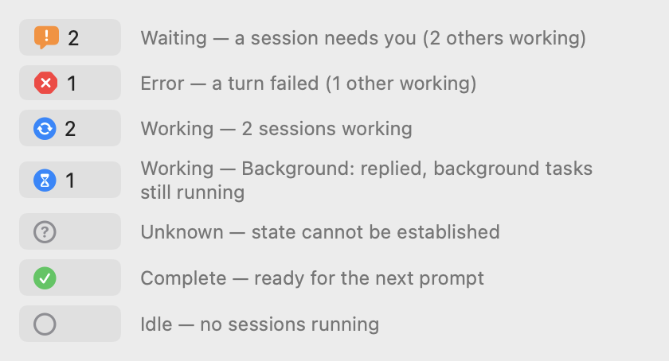
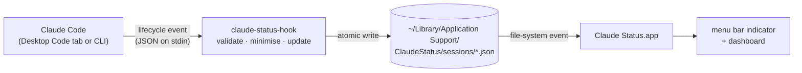

# Claude Status

**See what every local Claude Code session is doing — from the macOS menu bar.**

When you run several Claude Code sessions at once (in the Claude desktop app's Code tab, in
terminals, across projects and worktrees), it is easy to miss the one that has been waiting
for your approval for ten minutes, or to keep checking a window that finished long ago.
Claude Status puts one small indicator in the menu bar: **working**, **waiting for you**,
**complete** or **failed**, with a dashboard of every session one click away.

> Claude Status is an independent, unofficial open-source project. It is not affiliated with,
> sponsored by or endorsed by Anthropic. "Claude" and "Claude Code" are trademarks of Anthropic.

<p align="center">
  <picture>
    <source media="(prefers-color-scheme: dark)" srcset="docs/images/dashboard-dark.png">
    
  </picture>
  &nbsp;&nbsp;
  <picture>
    <source media="(prefers-color-scheme: dark)" srcset="docs/images/menubar-dark.png">
    
  </picture>
</p>

<sub>Screenshots are rendered by the app itself (`ClaudeStatus --render-snapshots DIR`) using demo sessions.</sub>

## Features

- **One glanceable indicator** whose colour *and* symbol show the most urgent state across all
  sessions, plus the number of sessions still working.
- **Session dashboard:** project (and git worktree), client (Desktop / CLI), state and reason
  ("Approval required", "API error: rate_limit", "2 subagents"…), live turn timer or time since
  completion with turn duration, and monitoring health.
- **Honest states.** A session is only *Complete* after Claude Code reports that the turn
  finished. Long silences become *Unknown*, never *Complete*. Subagents never mark their parent
  complete.
- **Optional notifications** for completion, approval requests and errors. All are off by default.
- **Native and light:** Swift/SwiftUI, Apple silicon, about 2 MB, idle CPU ≈0.06 %, about 19 MB of
  memory. No Electron, Node, Docker, network access, telemetry or listening ports.
- **Safe integration:** uses Claude Code's documented [hooks](https://code.claude.com/docs/en/hooks).
  The hook always exits successfully and prints nothing, so it can never block or change a
  Claude turn.

## Requirements and compatibility

- **Mac:** Apple silicon (arm64) only.
- **macOS:** 14 Sonoma or later (deployment target). CI builds and tests on macOS 15; real-world
  acceptance testing was done on macOS 27.2.
- **Claude Code:** a version with lifecycle hooks, including `StopFailure` and
  `PermissionRequest`. Verified with Claude Code CLI 2.1.325 and the Claude Code build bundled
  with Claude Desktop (2.1.330).

| Interface | Status | Evidence |
|---|---|---|
| **Claude Desktop — Code tab** (local sessions) | ✅ Verified | Real sessions: prompt → Working → Complete; permission request → Waiting → Working → Complete; sessions already running before installation picked up automatically |
| **Claude Code CLI** (interactive and `claude -p`) | ✅ Verified | Scripted pty acceptance test: Working/Complete, permission Waiting and approval, `/exit`, SIGKILL → Unknown, API error → Error |
| Several concurrent sessions (Desktop + CLI, many projects) | ✅ Verified | Tracked individually and aggregated |
| Claude Desktop — Chat | ❌ Not supported | Chats do not run Claude Code or its hooks |
| Cowork | ❌ Not supported | No documented hook integration |
| Cloud, remote or SSH sessions | ❌ Not supported | Their hooks run on the other machine |
| IDE extensions, Agent SDK apps | ⚠️ Untested | Likely work (same hooks); shown as "Unknown client" |

## Install

### Option A — download the app

1. Download `ClaudeStatus-<version>-macos-arm64.zip` from the
   [latest release](https://github.com/audiophreak/claude-status/releases/latest) and verify it:
   ```bash
   shasum -a 256 -c SHA256SUMS.txt
   gh attestation verify ClaudeStatus-*-macos-arm64.zip --repo audiophreak/claude-status
   ```
2. Unzip it and move **Claude Status.app** to `/Applications` (or `~/Applications`).
3. Open it. **The app is ad-hoc signed and not notarized by Apple** (this project has no paid
   Apple Developer account), so macOS blocks the first launch. Click **Done**, open
   **System Settings › Privacy & Security**, and next to *"Claude Status" was blocked…* click
   **Open Anyway**. This approves this one app only. Do not disable Gatekeeper. If you would rather
   not approve an unnotarized download, use Option B.
4. Click the menu bar icon › **Set Up Claude Code Hooks…** and confirm. See
   [What setup changes](#what-setup-changes).
5. Optional: **Preferences… › Launch at login**.

### Option B — build from source

Needs Xcode or the Command Line Tools with Swift 6. A locally built app is not quarantined, so no
Gatekeeper approval is needed.

```bash
git clone https://github.com/audiophreak/claude-status.git
cd claude-status
scripts/install.sh
```

`install.sh` runs the build, installs `~/Applications/Claude Status.app`, installs the helpers,
registers the hooks, starts the app and enables launch at login (`--no-login-item` to skip).
It needs no `sudo`.

## Reading the indicator

| Symbol | Colour | State | Meaning |
|---|---|---|---|
| exclamation bubble | amber | **Waiting** | A session needs you: approval, a question, plan approval or an MCP input request |
| ✕ in an octagon | red | **Error** | A turn ended with an API error, or a running tool was interrupted |
| circular arrows | blue | **Working** | Claude is executing a turn |
| ? in a circle | grey | **Unknown** | State can't be established (not yet observed, long silence, or the Claude process exited) |
| check mark | green | **Complete** | The last turn finished; ready for your next prompt |
| empty circle | grey | **Idle** | No active sessions |

The menu bar shows the most urgent state (Waiting › Error › Working › Unknown › Complete ›
Idle). The number next to it is how many sessions are **working**. A `≥` before a timer means
the turn started before Claude Status first saw it. **Clear Finished** removes completed,
ended and failed sessions. Working and waiting sessions are never removed.

**Preferences:** launch at login, working-session count, elapsed time in the menu bar,
working directories in the list, how long finished sessions are kept (1 hour to 7 days),
notifications (off by default; macOS asks for permission only when you enable one), and
Claude Code hook install / repair / removal.

## How it works



Claude Code runs the hook for 12 events (`SessionStart`, `UserPromptSubmit`, `PreToolUse`,
`PostToolUse`, `PostToolUseFailure`, `PermissionRequest`, `Notification`, `Stop`,
`StopFailure`, `SubagentStart`, `SubagentStop`, `SessionEnd`). A deterministic state machine
turns them into one small record per session, which the app watches. There is no daemon, no
socket and no polling of Claude. Hooks keep working when the app isn't running, and the app
catches up when it starts. Design details, state diagram and edge cases:
[docs/ARCHITECTURE.md](docs/ARCHITECTURE.md).

## What setup changes

Setup (the app's button, `"/Applications/Claude Status.app/Contents/MacOS/ClaudeStatus" --setup-hooks`,
`scripts/install.sh`, or `claude-status-ctl install-hooks`):

1. Copies `claude-status-hook` and `claude-status-ctl` to
   `~/Library/Application Support/ClaudeStatus/bin/`.
2. Saves a backup of `~/.claude/settings.json` (or `$CLAUDE_CONFIG_DIR/settings.json`) to
   `~/Library/Application Support/ClaudeStatus/backups/`.
3. Appends **one** handler per event to the `hooks` section:
   `{"type": "command", "command": "\"…/claude-status-hook\"", "timeout": 5}`.

Everything else in the file is left byte-for-byte as it was: other hooks, permissions, plugins,
formatting and key order. The edit is verified before it is written (removing the Claude Status
entries must reproduce the original exactly). It is abandoned if another program changes the
file at the same moment. Running setup again is a no-op. Running Claude Code sessions pick up
the change automatically through Claude Code's settings file watcher.

Check it yourself at any time:

```bash
CTL="$HOME/Library/Application Support/ClaudeStatus/bin/claude-status-ctl"
"$CTL" verify-hooks
"$CTL" verify-preserved --backup "$(ls "$HOME/Library/Application Support/ClaudeStatus/backups/"*.install.*.bak | head -1)"
```

## Privacy and security

- Stored per session: session ID, timestamps, state, working directory and project or worktree
  name, client type, Claude process ID, opaque tool-use IDs, counts, and the documented reason
  codes (for example `rate_limit`).
- **Never stored:** prompts, responses, tool names, tool input or output, transcript paths,
  session titles or error messages.
- All state is local (`~/Library/Application Support/ClaudeStatus`, user-only permissions).
- No network code, telemetry or listening ports. No Accessibility, Screen Recording or Full Disk
  Access permissions, no administrator rights, no private APIs and no modification of Claude Desktop.
- Hook input is treated as untrusted: size-bounded, strictly validated, never executed.

Details and threat model: [SECURITY.md](SECURITY.md). Report vulnerabilities privately via
[Security › Report a vulnerability](https://github.com/audiophreak/claude-status/security/advisories/new).

## Update and uninstall

- **Downloaded app, update:** quit Claude Status, replace the app with the new version, open it.
  It refreshes its installed helpers automatically.
- **Source build, update:** `git pull && scripts/update.sh`.
- **Downloaded app, uninstall:** Preferences › **Remove Hooks…**, turn off *Launch at login*,
  quit, and move the app to the Trash.
- **Source build, uninstall:** `scripts/uninstall.sh`. Add `--purge-state` to also delete
  history and logs, or `--purge-backups` to delete those and the settings backups too.

Uninstalling removes only Claude Status entries and keeps every other setting, including
changes made after installation. Old backups are never restored over a newer file. More detail:
[docs/OPERATIONS.md](docs/OPERATIONS.md).

## Troubleshooting

| Symptom | Fix |
|---|---|
| Dashboard shows *Claude Status hooks are not installed* or *helper missing* | Click **Set Up Claude Code Hooks…** (or `scripts/install.sh`) |
| A session doesn't appear | It hasn't fired a hook since setup. Send it a prompt. Interactive sessions in an untrusted folder hold back all hooks until you accept the trust dialog. |
| A session stays *Working* after you pressed Esc | Claude Code emits no hook for that (see below). The next prompt fixes it; otherwise it turns *Unknown* after 20 minutes. |
| *Unknown — process exited* | The Claude process ended without a normal exit (crash or kill). Use **Clear Finished**. |
| *Claude settings could not be parsed* | `settings.json` isn't valid JSON. Claude Status won't edit it until it is fixed. |
| Custom `CLAUDE_CONFIG_DIR` | The menu bar app checks `~/.claude/settings.json` unless it was launched with that variable. Use `claude-status-ctl install-hooks --settings "$CLAUDE_CONFIG_DIR/settings.json"`. |

Diagnostics: `"$HOME/Library/Application Support/ClaudeStatus/bin/claude-status-ctl" diagnose`
(or `scripts/diagnose.sh` from a checkout).

## Known limitations

- **Pressing Esc while Claude is writing text** emits no hook event in Claude Code (verified:
  nothing for 80 s). The session shows *Working* until your next prompt, or *Unknown* after
  20 minutes. It is never shown as *Complete*.
- **After you approve a permission**, the session stays *Waiting* until the approved tool
  finishes, because Claude Code has no "approved" event. If another tool auto-approves requests,
  *Waiting* may flash briefly.
- **Interrupting a running tool** is shown as *Error — Interrupted* when Claude Code reports it
  (`PostToolUseFailure` with `is_interrupt`). This path is unit-tested but wasn't observed in
  acceptance testing.
- **Client detection** (Desktop vs CLI) relies on environment variables Claude Code sets for
  hooks (`CLAUDE_CODE_ENTRYPOINT`, `CLAUDE_CODE_DESKTOP_APP_VERSION`). They were observed, not
  documented, and could change.
- **Simultaneous parallel tool calls** may be applied slightly out of order. The state stays
  correct, but the "running tool" detail is approximate.
- **Not exercised on real hardware:** sleep/wake handling (unit-tested) and notifications.
- **No notarization.** Downloads need the one-time *Open Anyway* approval described above.

## Development

```bash
swift build && swift test        # unit tests
scripts/test.sh                  # unit + integration + installer round-trip tests (fixtures only)
python3 scripts/acceptance/cli_acceptance.py   # real CLI acceptance test (uses your Claude plan)
```

See [CONTRIBUTING.md](CONTRIBUTING.md), [docs/TESTING.md](docs/TESTING.md) and
[docs/RELEASING.md](docs/RELEASING.md). Changes are listed in [CHANGELOG.md](CHANGELOG.md).

## Official documentation

- Claude Code hooks reference — https://code.claude.com/docs/en/hooks
- Claude Code hooks guide — https://code.claude.com/docs/en/hooks-guide
- Claude Code settings — https://code.claude.com/docs/en/settings
- Claude Desktop (Code tab) — https://code.claude.com/docs/en/desktop
- SwiftUI `MenuBarExtra` — https://developer.apple.com/documentation/swiftui/menubarextra
- `SMAppService` — https://developer.apple.com/documentation/servicemanagement/smappservice

## License

[MIT](LICENSE). Contributions are welcome under the same license. Please follow the
[Code of Conduct](CODE_OF_CONDUCT.md).
