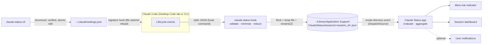
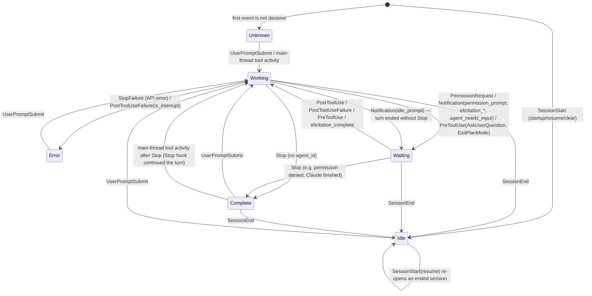

# Architecture

Claude Status is a native Swift/SwiftUI menu bar utility for Apple Silicon. It shows the
execution state of local Claude Code sessions (Claude Desktop's **Code** tab and the
**Claude Code CLI**) using Claude Code's documented lifecycle hooks.

## Components

| Component | Target | Role |
|---|---|---|
| Core library | `Sources/ClaudeStatusCore` | Event parsing and validation, deterministic state machine, atomic session store, time-based presentation rules, order-preserving `settings.json` editor, health checks. No UI. |
| Hook | `Sources/ClaudeStatusHook` → `claude-status-hook` | Run by Claude Code for every registered event. Reads the JSON payload on stdin, applies it to the session's record, exits 0, prints nothing. |
| Control CLI | `Sources/ClaudeStatusCtl` → `claude-status-ctl` | Install helpers, install / uninstall / verify hooks, verify preservation, diagnostics, session listing, state purge. |
| App | `Sources/ClaudeStatusApp` → `Claude Status.app` | `MenuBarExtra` indicator + dashboard, preferences window, hook setup/removal (with confirmation), optional notifications, login item. Bundles the two helpers in `Contents/Helpers`. |
| Scripts | `scripts/` | Build, test, install, update, diagnose, uninstall, acceptance tests. |

### Why per-session state files

* **No daemon and no ports.** The hook writes directly to the store; the app only reads.
  Hooks work whether or not the app is running, and the app recovers full state on launch.
* **Bounded storage.** One small file per session (≈0.5 KB), rather than an unbounded event spool.
* **Event-driven UI.** A `DispatchSource` vnode watcher on the `sessions/` directory fires on
  every `rename(2)`; the app re-reads within ~50 ms (debounced). A 30 s timer (10 s tolerance)
  handles time-based rules (staleness, retention, liveness) only.
* **Concurrency.** Claude Code runs hooks in parallel. All writers serialise on one advisory
  `flock` (`sessions/.store.lock`, held ≈1–3 ms). Waiting is bounded to 1 s, after which the
  hook gives up silently (fail open).

## Session state machine

The reducer `StateMachine.reduce(previous, event)` is pure and deterministic.

Rules that keep the state honest:

| Situation | Handling |
|---|---|
| Subagents | Events with `agent_id` never complete the parent. `Stop`/`SubagentStop` from a subagent are activity only. Background-subagent activity after the main `Stop` keeps the session Complete. |
| Stop semantics | `Stop` is treated as completion, but any later main-thread tool event re-opens the turn as Working ("Continuing"): this is exactly what happens when another Stop hook blocks the stop (`decision: "block"`). |
| Tool failures | `PostToolUseFailure` keeps the turn Working (ordinary tool errors do not end a turn). Only `is_interrupt: true` from the main thread ends it as Error ("Interrupted"). |
| Terminal failures | `StopFailure` → Error with the documented error category (`rate_limit`, `server_error`, …). |
| Duplicates | Every transition is idempotent; repeating an event does not change the result. |
| Out-of-order | Events older than the last applied event by up to 120 s (concurrent hook processes acquiring the lock in a different order) are ignored and counted. A larger gap is treated as a wall-clock change and accepted. |
| Missing events | First event mid-turn → Working with "≥" elapsed time (turn start not observed). Never infers Complete without a `Stop`. |
| Compaction | `SessionStart(source=compact)` mid-turn leaves the state unchanged. |
| Resume | Any event after `SessionEnd` re-opens the session. |

### Time-dependent presentation (app side, `Presentation.evaluate`)

| Condition | Displayed |
|---|---|
| `SessionEnd` seen | Idle — "Session ended" (excluded from the aggregate) |
| Recorded Claude process no longer alive (PID + start time, PID-reuse safe) while Working/Waiting | Unknown — "Claude process exited without ending the session" |
| … while Complete/Error/Idle | treated as ended |
| Working, no event for 20 min and no tool in flight | Unknown — "No activity for …" |
| Working, no event for 120 min with a tool in flight (long builds/tests) | Unknown |
| Waiting | never goes stale (a person may take any amount of time) |

Silence before the most recent system wake is not counted. The app never shows Complete
because events stopped.

### Aggregate indicator

Precedence: **Waiting > Error > Working > Unknown > Complete > Idle** (ended sessions are
excluded). The menu bar shows the aggregate symbol plus the number of Working sessions, so a
Waiting or Error indicator still shows how many sessions are working.

## Data captured

Only these fields are kept per session: session ID, event name, timestamps, `cwd`,
`CLAUDE_PROJECT_DIR`, git repository / worktree name (derived from `.git` on disk), client
type, entrypoint label, Claude process PID and start time, tool-use IDs currently in flight
(opaque IDs, no names or arguments), subagent and background-task counts, documented
`SessionStart.source`, `SessionEnd.reason`, `Notification.notification_type` and
`StopFailure.error` category values. Prompts, tool inputs and outputs, transcript paths,
assistant messages, session titles and error details are never stored.

## Client identification

The hook payload has no documented Desktop/CLI field. Claude Status reads two environment
variables Claude Code sets for hook processes (observed on this system, not documented):
`CLAUDE_CODE_ENTRYPOINT` (`claude-desktop`; `cli`, or `sdk-cli` for `claude -p`) and
`CLAUDE_CODE_DESKTOP_APP_VERSION`.
Anything else is reported as "Unknown client" rather than guessed.

The Claude process is identified from `CLAUDE_PID` (validated: same user, executable named
`claude`) or by walking up to six ancestors of the hook process.

## Settings editing (`HookConfigurator`)

* Order-preserving JSON parser/writer (`OrderedJSON.swift`) reproduces Claude Code's
  `JSON.stringify(…, null, 2)` format byte-for-byte, keeps key order and original number
  text, so the installation diff is purely additive.
* Claude Status handlers are identified by the `claude-status-hook` marker in `command`.
* Before writing: `normalized(new) == normalized(original)` (everything except Claude Status
  handlers is identical) and the result reports fully installed.
* A timestamped 0600 backup of the original bytes is written first.
* The file is re-read immediately before `rename(2)`; any difference aborts the update
  (`concurrentModification`) and `claude-status-ctl` retries up to 3 times from a fresh read.
* After writing, the file is re-read and compared with the intended content.
* Symlinked settings files are edited at their target; the file mode is preserved.

## Helper installation

`HelperInstaller` copies `claude-status-hook` and `claude-status-ctl` from the app bundle (or a
build) to `~/Library/Application Support/ClaudeStatus/bin`, as new files (read, temp file,
`fsync`, `rename(2)`), so a hook running at that moment always sees a complete binary. The
registered hook path therefore stays valid if the app is moved or updated. After an update the
app refreshes already-installed helpers whose bytes differ from its bundled copies.

## Settings file location

`$CLAUDE_CONFIG_DIR/settings.json` if set, otherwise `$HOME/.claude/settings.json`, matching
Claude Code. Scripts pass explicit paths to `claude-status-ctl`, which keeps the installer test
isolated in a temporary `HOME`.

## Resource profile

See `docs/TESTING.md` → Measurements.
