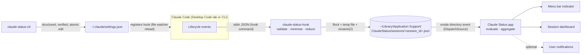
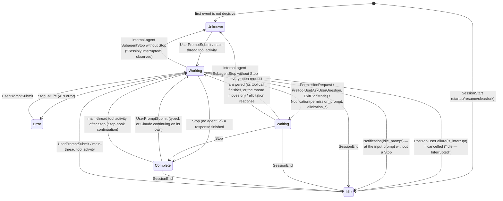

# Architecture

Claude Status is a native Swift/SwiftUI menu bar utility for Apple Silicon. It shows the
execution state of local Claude Code sessions (Claude Desktop's **Code** tab and the
**Claude Code CLI**) using Claude Code's documented lifecycle hooks.

## Components

| Component | Target | Role |
|---|---|---|
| Core library | `Sources/ClaudeStatusCore` | Event parsing and validation, deterministic state machine, atomic session store, time-based presentation rules, order-preserving `settings.json` editor, health checks. No UI. |
| Hook | `Sources/ClaudeStatusHook` → `claude-status-hook` | Run by Claude Code for every registered event. Reads the JSON payload on stdin, applies it to the session's record, exits 0, prints nothing. |
| Control CLI | `Sources/ClaudeStatusCtl` → `claude-status-ctl` | Install helpers, install / uninstall / verify hooks, verify preservation, diagnostics, session listing, state purge. |
| App | `Sources/ClaudeStatusApp` → `Claude Status.app` | `MenuBarExtra` indicator + dashboard, preferences window, hook setup/removal (with confirmation), optional notifications, login item. Bundles the two helpers in `Contents/Helpers`. |
| Scripts | `scripts/` | Build, test, install, update, diagnose, uninstall, acceptance tests. |

### Why per-session state files

* **No daemon and no ports.** The hook writes directly to the store; the app only reads.
  Hooks work whether or not the app is running, and the app recovers full state on launch.
* **Bounded storage.** One small file per session (≈0.5 KB), rather than an unbounded event spool.
* **Event-driven UI.** A `DispatchSource` vnode watcher on the `sessions/` directory fires on
  every `rename(2)`; the app re-reads within ~50 ms (debounced). A 30 s timer (10 s tolerance)
  handles time-based rules (staleness, retention, liveness) only.
* **Concurrency.** Claude Code runs hooks in parallel. All writers serialise on one advisory
  `flock` (`sessions/.store.lock`, held ≈1–3 ms). Waiting is bounded to 1 s, after which the
  hook gives up silently (fail open).

## Session state model

Claude Status answers "is Claude still doing work?", not merely "has the last response
finished?". Each session is described by independent dimensions, and the displayed status is
derived from them. Every rule below is either a documented interface (hooks reference) or a
behaviour observed live on Claude Code Desktop 2.1.330 and CLI 2.1.325 (recorded, sanitized
sequences in `Tests/Fixtures/recorded/`, replayed by `RecordedSequenceTests`). Observed
behaviour is marked as such; it is not assumed to be stable.

| Dimension | Source | Stored as |
|---|---|---|
| Identity and discovery | `session_id`; Claude PID + start time; running `claude` processes (libproc) | record file; in-memory process scan |
| Foreground turn | `UserPromptSubmit` … `Stop` / `StopFailure` | `state` (Working, Waiting, Complete, Error, Idle, Unknown) |
| Background work | documented `background_tasks` array on `Stop` and `SubagentStop` | `background` (id, type, status per task) + `backgroundReportedAt` |
| Background evidence | subagent tool events (`agent_id`) while the foreground is not running | `backgroundActivityAt` |
| Scheduled continuation | documented `session_crons` array on `Stop` and `SubagentStop` | `schedules` (one-shot / recurring counts, next one-shot time) |
| User attention | `PermissionRequest` (per tool call), `Notification`, `AskUserQuestion` / `ExitPlanMode` | `state = waiting` + reason + `awaitingPermission` |
| Terminal failure | `StopFailure` | `state = error` + category |
| Cancellation | `PostToolUseFailure` with `is_interrupt`; internal-agent `SubagentStop` mid-turn (observed) | `reason = interrupted` |
| Liveness | PID + start time (PID-reuse safe), `SessionEnd`, kernel wake time | evaluated on display |
| Confidence | mid-session observation, report age, silence, unreported background | `EffectiveSession.confidence` + note |

### Foreground reducer

`StateMachine.reduce(previous, event)` is pure and deterministic. `state` is the foreground
turn only.

#### Permission and user-input requests

`PermissionRequest` carries no `tool_use_id`, so it is matched to the most recent in-flight
tool call of the same name in the same thread (main thread or one subagent, by `agent_id`).
Waiting ends only when **every** open request is answered: the requested tool call finishes
(`PostToolUse` / `PostToolUseFailure`), or a later tool call in the same thread starts
(Claude moved on after a denial). Other tools finishing in parallel, and background subagent
activity, do not end Waiting. `AskUserQuestion` and `ExitPlanMode` also pass through the
permission flow (observed: `PreToolUse` → `PermissionRequest` → `Notification permission_prompt`
→ `PostToolUse`); they stay "Question for you" / "Plan approval required" instead of becoming
"Approval required".

Observed limitation (CLI): declining a permission request or a question with Esc emits **no
event**. The session then stays Waiting — which is still true, because Claude is waiting for
the user's next instruction — until the next prompt.

#### Interrupts and cancellation

| Situation | Events (observed) | Displayed |
|---|---|---|
| CLI: Esc while text is generated | none (no `Stop`, no `idle_prompt` within 80 s) | Working until the next event; confidence drops after 5 min; Unknown after 20 min |
| Desktop: Stop button during a tool or while generating | sometimes the internal prompt-suggestion agent's `SubagentStop` (`agent_type` empty) — seen in 3 of 4 runs; otherwise nothing | **Unknown — Possibly interrupted** when it arrives; otherwise as the row above (Bash in flight: partial after 11 min, Unknown after 60) |
| Tool aborted (`PostToolUseFailure` with `is_interrupt`) | documented | **Idle — Interrupted** (gray, not red); later main-thread activity resumes Working |
| API error | `StopFailure` (documented categories) | **Error** (red) |
| Background task cancelled (`TaskStop`) | its entry disappears from the next `Stop` report | Complete when nothing else runs |

The internal-agent rule uses documented facts (internal agents fire `SubagentStop` with an
empty `agent_type`; prompt suggestions are generated when a turn ended) and an observed one
(Desktop fires it after a stop). `/btw` also uses an internal agent, so a side question asked
during a long tool can briefly show Unknown; the turn's next event resumes Working. The state
is never Complete or Error without a `Stop` / `StopFailure`.

### Background work and automatic continuation

`Stop` means *the main agent finished responding*. It does **not** mean the session's work is
done: Claude Code documents that the `background_tasks` and `session_crons` arrays on `Stop`
"let hooks distinguish 'session is done' from 'session is paused waiting for background work
to wake it back up'". Claude Status therefore:

* keeps, per session, the in-flight tasks of the latest report (only `id`, `type` and
  `status`; never `description` or `command`) and **when** it was reported. Tasks whose status
  is terminal (`completed`, `failed`, `killed`, `cancelled`, …) are dropped; unknown statuses
  count as running;
* updates the report from `SubagentStop` too (its arrays are scoped to the parent session);
* treats an absent array as **not reported** (unknown), never as "no background work";
* keeps the report across new turns until the next `Stop` replaces it, and forgets it on
  `SessionStart(startup|resume)` (new process) and `SessionEnd`;
* shows counts as **last reported** ("1 task (shell) · reported 20m ago"; during a later turn
  "… at last report · updated when this turn ends"), because no event fires when an
  individual task exits;
* records subagent tool events that arrive while the foreground is idle as direct evidence of
  background subagent activity ("subagent active").

Observed on both clients: when a background shell, monitor or subagent finishes, Claude Code
starts a new turn on its own **with `UserPromptSubmit`** (documented: it "fires on turns
Claude Code starts on its own"), and its `Stop` carries the updated `background_tasks`. The
payload does not say whether a prompt was typed, so a new turn while background work or a
wakeup was pending is labelled **Working — Continuing** with a detail saying it may also be a
new prompt. Background types observed: `shell`, `subagent`, `monitor` (Desktop; the CLI
2.1.325 reported a monitor as `shell`).

`TaskCreated` / `TaskCompleted` concern the task *list* (`TaskCreate` / `TaskUpdate`) and are
deliberately not used for background work.

### Scheduled continuation

`session_crons` entries (from `CronCreate`, `ScheduleWakeup`, `/loop`) carry a five-field cron
expression and `recurring`. For one-shot entries Claude Status computes the next firing time
(local time; `CronSchedule`) and shows **Continuation scheduled — Claude continues at 14:05**
in teal with a clock symbol. It is not counted as executing work (menu bar count, summary
"1 scheduled"). A wakeup more than 5 minutes overdue without any event lowers confidence.
Observed: the wakeup fires a `UserPromptSubmit` at the scheduled minute; `CronDelete` removes
the entry from the next report.

### Derived status (`Presentation.evaluate`)

| Foreground | Background report | Displayed |
|---|---|---|
| Working | any | **Working** (foreground / background lines when tasks were reported) |
| Complete | ≥ 1 running task | **Working — Background** |
| Complete | none running, ≥ 1 one-shot wakeup | **Continuation scheduled** (with time) |
| Complete | none, no one-shot wakeup | **Complete** (recurring schedules are shown as detail) |
| Complete | not reported | **Unknown** — "background work not reported by Claude Code" |
| New turn while background work / a wakeup was pending | — | **Working — Continuing** |
| Waiting / Error | any | Waiting / Error (background shown on its own line) |
| Idle — Interrupted | ≥ 1 running task | **Working — Background** (background is cancelled independently) |
| Unknown (not yet observed) | ≥ 1 running task | **Working — Background** (confidence partial) |
| *(running process, no event yet)* | — | **Unknown — Not observed** |

Then time and liveness. Silence is measured from the later of the last event and the last
system wake (`kern.waketime`), because Claude Code is suspended while the Mac sleeps.

| Condition | Displayed |
|---|---|
| `SessionEnd` seen | Idle — "Session ended" (excluded from the aggregate) |
| Recorded Claude process gone (PID + start time) while work was active, pending or unknown | Unknown — "process exited" |
| … while the foreground finished and nothing was pending | treated as ended |
| Working, no tool in flight: 5 min without an event | Working, confidence partial ("no event for …") |
| Working, no tool in flight: 20 min without an event | Unknown — "possibly interrupted (Esc is not reported)" |
| Working, only Bash calls in flight: 11 min / 60 min | partial / Unknown |
| Working, other tool in flight: 30 min / 120 min | partial / Unknown |
| Working — Background: report older than 1 h | still Working — Background while the process runs; confidence partial |
| Waiting | never goes stale |

Rationale for the thresholds: a single response without tool calls is bounded by the model's
output limit, so 20 minutes of silence is far beyond a normal response; a foreground Bash call
is bounded by its timeout (10 minutes at most unless `BASH_MAX_TIMEOUT_MS` is raised), hence
11 / 60 minutes; MCP and other tools may run longer, hence 30 minutes / 2 hours.
Background work has no bound (servers, monitors, long rehearsals), so 1.0.1's 8-hour cut-off
to Unknown was removed: while the process runs the work stays visible with an explicit report
age, and process exit resolves it. The app never shows Complete, Idle or Error because events
stopped.

### Existing-session discovery

Claude Code reloads hook settings in running sessions (verified for sessions started a day
before installation), so no restart is ever needed; but a session that is idle or waiting on
a background command fires no event until its next turn. The app therefore scans same-user
processes named `claude` with libproc every 10–30 s and immediately after wake (executable
path, start time, working directory; nothing else) and matches them to records by PID **and**
start time (a reused PID never matches). A record without a PID matches only a process in the
same folder that already ran at the record's last event. A process with no matching record is
listed as **Unknown — Not observed** with its folder name and client, counts as Unknown in the
aggregate and as a coverage gap in health, and becomes a normal row on its first hook event.
Several sessions in the same folder or worktree are separate rows (one per process). Processes
younger than 5 s are skipped while their `SessionStart` arrives.

Claude Code also writes an undocumented per-process registry (`~/.claude/sessions/<pid>.json`)
with the session ID and a busy/idle status. It is **not used**: it is undocumented, it holds
session titles, and its status read `idle` for a session whose background command was still
running.

### Clear Finished, retention and storage bounds

A finished session whose Claude process is still running is **hidden** (`dismissed`), not
deleted, so its process stays correlated and never turns into an unobserved session; its next
event shows it again. Ended sessions and sessions whose process exited are deleted after the
retention period. Working (including background and scheduled), Waiting and undetermined
sessions are never touched. Storage is bounded: beyond 200 records the oldest ended or
exited records are deleted first; the hook log rotates at 256 KB (one previous file kept).

### Other rules

| Situation | Handling |
|---|---|
| Subagents | Events with `agent_id` never complete the parent; while the parent is idle they are background evidence, not a new foreground turn. Background subagents appear in `background_tasks` as `subagent`. |
| Tool failures | `PostToolUseFailure` keeps the turn Working. |
| Duplicates | Every transition is idempotent. |
| Out-of-order | Events older than the last applied event by up to 120 s are ignored and counted; a larger gap is treated as a clock change. |
| Missing events | First event mid-turn → Working with "≥" elapsed time and partial confidence. Never infers Complete without a `Stop` that reports no background work. |
| Compaction | `SessionStart(source=compact)` mid-turn leaves the state unchanged. |
| Resume | Any event after `SessionEnd` re-opens the session. |
| Termination | SIGTERM: Claude Code fires `SessionEnd` (reason `other`, observed). SIGKILL / crash: no event; process exit is detected by liveness. |

### Aggregate indicator

Precedence: **Waiting > Error > Working > Unknown > Complete > Idle** (ended and hidden
sessions are excluded; unobserved sessions count as Unknown). Working includes Working —
Background and Continuation scheduled. Symbols: circular arrows (foreground work), hourglass
(only background work), teal clock (only scheduled continuations), speech bubble (Waiting),
octagon (Error), question mark (Unknown or unobserved sessions), checkmark (Complete), empty
circle (Idle). The number next to the symbol counts sessions executing work now (foreground
or background, not scheduled). The dashboard header lists working, background, scheduled,
waiting, error, unknown and complete counts; each row's tooltip lists the evidence
(foreground, background, last event, confidence).

### Monitoring health

Health reports separately: app running, hooks installed (structured check of
`settings.json`), hook executable present, hooks executing (last run, rejected/failed runs in
the diagnostic log), event ingestion (state directory, unreadable records), coverage ("N of M
running sessions observed"), and background-task visibility. Per session: discovered
(process) vs observed (hook events), foreground and background confidence, last event.
Incomplete coverage is a warning, never "Monitoring active". `claude-status-ctl diagnose`
prints the same plus the PID → session mapping, `claude-status-ctl selftest` runs the
installed hook against an isolated store, and `claude-status-ctl report` produces a sanitized
Markdown report for bug reports.

## Data captured

Only these fields are kept per session: session ID, event name, timestamps, `cwd`,
`CLAUDE_PROJECT_DIR`, git repository / worktree name (derived from `.git` on disk), client
type, entrypoint label, Claude process PID and start time, tool-use IDs currently in flight
with their tool names (no arguments), which of them await a permission decision, subagent
counts, background tasks (opaque `id`, `type` label and `status` only — never `description`
or `command`), scheduled-wakeup counts and the next one-shot time computed from the cron
expression (never the scheduled prompt), documented `SessionStart.source`, `SessionEnd.reason`,
`Notification.notification_type` and `StopFailure.error` category values. Prompts, tool
inputs and outputs, transcript paths, assistant messages, session titles and error details
are never stored. Records stay readable by every 1.x version (schema 1, optional fields
only), which keeps rollback safe.

## Client identification

The hook payload has no documented Desktop/CLI field. Claude Status reads two environment
variables Claude Code sets for hook processes (observed on this system, not documented):
`CLAUDE_CODE_ENTRYPOINT` (`claude-desktop`; `cli`, or `sdk-cli` for `claude -p`) and
`CLAUDE_CODE_DESKTOP_APP_VERSION`.
Anything else is reported as "Unknown client" rather than guessed.

The Claude process is identified from `CLAUDE_PID` (validated: same user, executable named
`claude`) or by walking up to six ancestors of the hook process.

## Settings editing (`HookConfigurator`)

* Order-preserving JSON parser/writer (`OrderedJSON.swift`) reproduces Claude Code's
  `JSON.stringify(…, null, 2)` format byte-for-byte, keeps key order and original number
  text, so the installation diff is purely additive.
* Claude Status handlers are identified by the `claude-status-hook` marker in `command`.
* Before writing: `normalized(new) == normalized(original)` (everything except Claude Status
  handlers is identical) and the result reports fully installed.
* A timestamped 0600 backup of the original bytes is written first.
* The file is re-read immediately before `rename(2)`; any difference aborts the update
  (`concurrentModification`) and `claude-status-ctl` retries up to 3 times from a fresh read.
* After writing, the file is re-read and compared with the intended content.
* Symlinked settings files are edited at their target; the file mode is preserved.

## Helper installation

`HelperInstaller` copies `claude-status-hook` and `claude-status-ctl` from the app bundle (or a
build) to `~/Library/Application Support/ClaudeStatus/bin`, as new files (read, temp file,
`fsync`, `rename(2)`), so a hook running at that moment always sees a complete binary. The
registered hook path therefore stays valid if the app is moved or updated. After an update the
app refreshes already-installed helpers whose bytes differ from its bundled copies.

## Settings file location

`$CLAUDE_CONFIG_DIR/settings.json` if set, otherwise `$HOME/.claude/settings.json`, matching
Claude Code. Scripts pass explicit paths to `claude-status-ctl`, which keeps the installer test
isolated in a temporary `HOME`.

## Resource profile

See `docs/TESTING.md` → Measurements.
