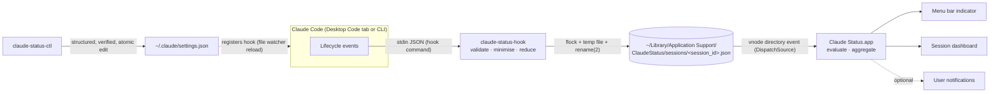
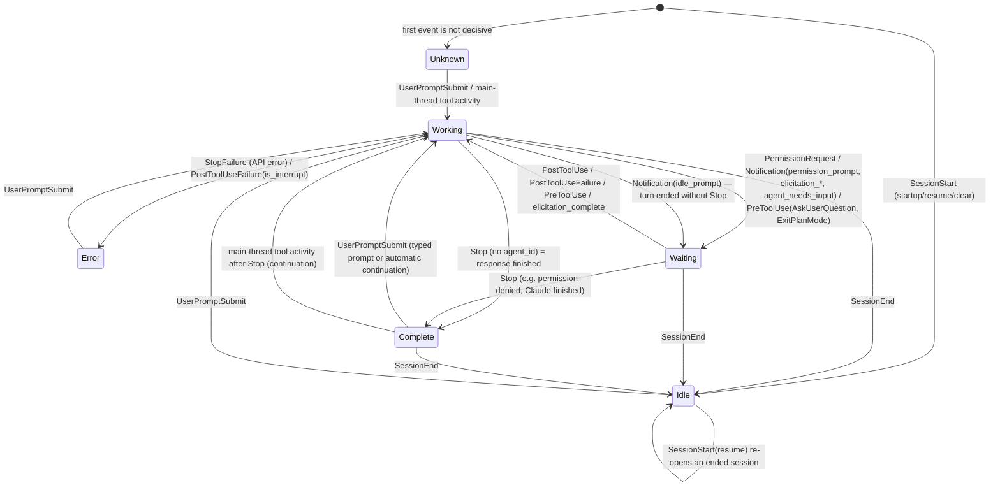

# Architecture

Claude Status is a native Swift/SwiftUI menu bar utility for Apple Silicon. It shows the
execution state of local Claude Code sessions (Claude Desktop's **Code** tab and the
**Claude Code CLI**) using Claude Code's documented lifecycle hooks.

## Components

| Component | Target | Role |
|---|---|---|
| Core library | `Sources/ClaudeStatusCore` | Event parsing and validation, deterministic state machine, atomic session store, time-based presentation rules, order-preserving `settings.json` editor, health checks. No UI. |
| Hook | `Sources/ClaudeStatusHook` → `claude-status-hook` | Run by Claude Code for every registered event. Reads the JSON payload on stdin, applies it to the session's record, exits 0, prints nothing. |
| Control CLI | `Sources/ClaudeStatusCtl` → `claude-status-ctl` | Install helpers, install / uninstall / verify hooks, verify preservation, diagnostics, session listing, state purge. |
| App | `Sources/ClaudeStatusApp` → `Claude Status.app` | `MenuBarExtra` indicator + dashboard, preferences window, hook setup/removal (with confirmation), optional notifications, login item. Bundles the two helpers in `Contents/Helpers`. |
| Scripts | `scripts/` | Build, test, install, update, diagnose, uninstall, acceptance tests. |

### Why per-session state files

* **No daemon and no ports.** The hook writes directly to the store; the app only reads.
  Hooks work whether or not the app is running, and the app recovers full state on launch.
* **Bounded storage.** One small file per session (≈0.5 KB), rather than an unbounded event spool.
* **Event-driven UI.** A `DispatchSource` vnode watcher on the `sessions/` directory fires on
  every `rename(2)`; the app re-reads within ~50 ms (debounced). A 30 s timer (10 s tolerance)
  handles time-based rules (staleness, retention, liveness) only.
* **Concurrency.** Claude Code runs hooks in parallel. All writers serialise on one advisory
  `flock` (`sessions/.store.lock`, held ≈1–3 ms). Waiting is bounded to 1 s, after which the
  hook gives up silently (fail open).

## Session state model

Claude Status answers "is Claude still doing work?", not merely "has the last response
finished?". Each session is described by independent dimensions, and the displayed status is
derived from them:

| Dimension | Source | Stored as |
|---|---|---|
| Identity and discovery | `session_id`; Claude PID + start time; running `claude` processes (libproc) | record file; in-memory process scan |
| Foreground turn | `UserPromptSubmit` … `Stop` / `StopFailure` | `state` (Working, Waiting, Complete, Error, Idle, Unknown) |
| Background work | documented `background_tasks` array on `Stop` and `SubagentStop` | `background` (id, type, status per task) |
| Scheduled continuation | documented `session_crons` array on `Stop` and `SubagentStop` | `schedules` (one-shot / recurring counts) |
| User attention | `PermissionRequest`, `Notification`, `AskUserQuestion` / `ExitPlanMode` | `state = waiting` + reason |
| Terminal failure | `StopFailure`; `PostToolUseFailure` with `is_interrupt` | `state = error` + category |
| Liveness | PID + start time (PID-reuse safe), `SessionEnd` | evaluated by the app |
| Confidence | first event mid-session / mid-turn; unreported background; staleness | `EffectiveSession.confidence` |

### Foreground reducer

`StateMachine.reduce(previous, event)` is pure and deterministic. `state` is the foreground
turn only.

### Background work and automatic continuation

`Stop` means *the main agent finished responding*. It does **not** mean the session's work is
done: Claude Code documents that the `background_tasks` and `session_crons` arrays on `Stop`
"let hooks distinguish 'session is done' from 'session is paused waiting for background work
to wake it back up'". Claude Status therefore:

* keeps, per session, the in-flight tasks of the latest report (only `id`, `type` and
  `status`; never `description` or `command`). Tasks whose status is terminal (`completed`,
  `failed`, `killed`, `cancelled`, …) are dropped; unknown statuses count as running;
* updates the report from `SubagentStop` too (its arrays are scoped to the parent session);
* treats an absent array as **not reported** (unknown), never as "no background work";
* keeps the report across new turns until the next `Stop` replaces it, and forgets it on
  `SessionStart(startup|resume)` (new process) and `SessionEnd`;
* marks main-thread activity after `Stop` as an automatic continuation (`autoContinued`) when
  background work or a one-shot wakeup was pending, otherwise as a Stop-hook continuation.

Observed on Claude Code 2.1.330 (Desktop) and the CLI: when a background shell command exits,
Claude Code starts a new turn on its own **with a `UserPromptSubmit` event** (the hooks
reference lists this for background subagents, scheduled tasks and messages), runs it, and
fires `Stop` with the updated `background_tasks`. No event fires while the command runs. A
command that fails or is stopped is reported the same way; its entry simply disappears from
the next report.

`TaskCreated` / `TaskCompleted` concern the task *list* (`TaskCreate` / `TaskUpdate`) and are
deliberately not used for background work.

### Derived status (`Presentation.evaluate`)

| Foreground | Background report | Displayed |
|---|---|---|
| Working | any | **Working** (detail adds "· N background tasks") |
| Complete | ≥ 1 running task | **Working — Background** |
| Complete | none running, ≥ 1 one-shot wakeup | **Working — Continuation scheduled** |
| Complete | none, no one-shot wakeup | **Complete** (recurring schedules are shown as detail) |
| Complete | not reported | **Unknown** — "background work not reported by Claude Code" |
| Working after a pending report | — | **Working — Continuing** |
| Waiting / Error | any | Waiting / Error (detail adds background count) |
| *(running process, no event yet)* | — | **Unknown — Not observed** |

Then time and liveness:

| Condition | Displayed |
|---|---|
| `SessionEnd` seen | Idle — "Session ended" (excluded from the aggregate) |
| Recorded Claude process no longer alive (PID + start time) while Working, Waiting, Unknown or background work pending | Unknown — "process exited" |
| … while the foreground finished and nothing was pending | treated as ended |
| Working, no event for 20 min and no tool in flight | Unknown — "No activity for …" |
| Working, no event for 120 min with a tool in flight | Unknown |
| Working — Background / Continuation scheduled, no event for 8 h | Unknown — "Background work not confirmed for …" |
| Waiting | never goes stale |

Silence before the most recent system wake is not counted. The app never shows Complete
because events stopped.

### Existing-session discovery

Claude Code reloads hook settings in running sessions (verified for sessions started a day
before installation), so no restart is ever needed; but a session that is idle or waiting on
a background command fires no event until its next turn. The app therefore scans same-user
processes named `claude` with libproc every 10–30 s (executable path, start time, working
directory; nothing else) and matches them to records by PID and start time, or by working
directory for records without a PID. A process with no matching record is listed as
**Unknown — Not observed** with its folder name and client (Desktop when the executable lives
in Claude's Application Support folder or an ancestor is inside `Claude.app`). It counts as
Unknown in the aggregate and as a coverage gap in health, and becomes a normal row on its
first hook event. Processes younger than 5 s are skipped while their `SessionStart` arrives.

Claude Code also writes an undocumented per-process registry (`~/.claude/sessions/<pid>.json`)
with the session ID and a busy/idle status. It is **not used**: it is undocumented, it holds
session titles, and its status read `idle` for a session whose background command was still
running, so it would not have prevented the defect.

### Clear Finished and retention

A finished session whose Claude process is still running is **hidden** (`dismissed`), not
deleted, so its process stays correlated and never turns into an unobserved session; its next
event shows it again. Ended sessions and sessions whose process exited are deleted. Working
(including background), Waiting and undetermined sessions are never touched. Retention never
deletes a record whose process is alive.

### Other rules

| Situation | Handling |
|---|---|
| Subagents | Events with `agent_id` never complete the parent. Background subagents appear in `background_tasks` as `subagent` tasks. |
| Tool failures | `PostToolUseFailure` keeps the turn Working. Only `is_interrupt: true` from the main thread ends it as Error ("Interrupted"). |
| Terminal failures | `StopFailure` → Error with the documented error category. |
| Duplicates | Every transition is idempotent. |
| Out-of-order | Events older than the last applied event by up to 120 s are ignored and counted; a larger gap is treated as a clock change. |
| Missing events | First event mid-turn → Working with "≥" elapsed time. Never infers Complete without a `Stop` that reports no background work. |
| Compaction | `SessionStart(source=compact)` mid-turn leaves the state unchanged. |
| Resume | Any event after `SessionEnd` re-opens the session. |

### Aggregate indicator

Precedence: **Waiting > Error > Working > Unknown > Complete > Idle** (ended and hidden
sessions are excluded; unobserved sessions count as Unknown). Working includes Working —
Background; the menu bar uses an hourglass instead of the circular arrows when every working
session is only doing background work. The number next to the symbol counts working sessions.

### Monitoring health

Health reports separately: hooks installed (structured check of `settings.json`), hook
executable present, hooks executing (time of the last hook run and rejected/failed runs in the
diagnostic log), event ingestion (state directory, directory watcher, unreadable records),
coverage ("N of M running sessions observed"), and background-task visibility (whether any
`Stop` reported `background_tasks`). Incomplete coverage is a warning, never "Monitoring
active". `claude-status-ctl diagnose` prints the same plus the PID → session mapping, and
`claude-status-ctl selftest` runs the installed hook against an isolated store to validate
emission, ingestion and state derivation end to end.

## Data captured

Only these fields are kept per session: session ID, event name, timestamps, `cwd`,
`CLAUDE_PROJECT_DIR`, git repository / worktree name (derived from `.git` on disk), client
type, entrypoint label, Claude process PID and start time, tool-use IDs currently in flight
(opaque IDs, no names or arguments), subagent counts, background tasks (opaque `id`, `type`
label and `status` only — never `description` or `command`), scheduled-wakeup counts, documented
`SessionStart.source`, `SessionEnd.reason`, `Notification.notification_type` and
`StopFailure.error` category values. Prompts, tool inputs and outputs, transcript paths,
assistant messages, session titles and error details are never stored.

## Client identification

The hook payload has no documented Desktop/CLI field. Claude Status reads two environment
variables Claude Code sets for hook processes (observed on this system, not documented):
`CLAUDE_CODE_ENTRYPOINT` (`claude-desktop`; `cli`, or `sdk-cli` for `claude -p`) and
`CLAUDE_CODE_DESKTOP_APP_VERSION`.
Anything else is reported as "Unknown client" rather than guessed.

The Claude process is identified from `CLAUDE_PID` (validated: same user, executable named
`claude`) or by walking up to six ancestors of the hook process.

## Settings editing (`HookConfigurator`)

* Order-preserving JSON parser/writer (`OrderedJSON.swift`) reproduces Claude Code's
  `JSON.stringify(…, null, 2)` format byte-for-byte, keeps key order and original number
  text, so the installation diff is purely additive.
* Claude Status handlers are identified by the `claude-status-hook` marker in `command`.
* Before writing: `normalized(new) == normalized(original)` (everything except Claude Status
  handlers is identical) and the result reports fully installed.
* A timestamped 0600 backup of the original bytes is written first.
* The file is re-read immediately before `rename(2)`; any difference aborts the update
  (`concurrentModification`) and `claude-status-ctl` retries up to 3 times from a fresh read.
* After writing, the file is re-read and compared with the intended content.
* Symlinked settings files are edited at their target; the file mode is preserved.

## Helper installation

`HelperInstaller` copies `claude-status-hook` and `claude-status-ctl` from the app bundle (or a
build) to `~/Library/Application Support/ClaudeStatus/bin`, as new files (read, temp file,
`fsync`, `rename(2)`), so a hook running at that moment always sees a complete binary. The
registered hook path therefore stays valid if the app is moved or updated. After an update the
app refreshes already-installed helpers whose bytes differ from its bundled copies.

## Settings file location

`$CLAUDE_CONFIG_DIR/settings.json` if set, otherwise `$HOME/.claude/settings.json`, matching
Claude Code. Scripts pass explicit paths to `claude-status-ctl`, which keeps the installer test
isolated in a temporary `HOME`.

## Resource profile

See `docs/TESTING.md` → Measurements.
